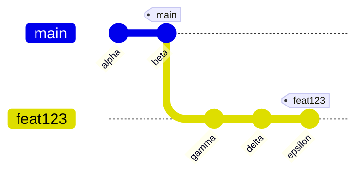
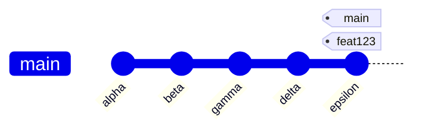
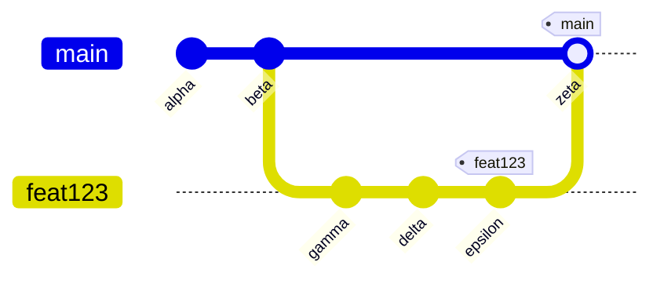

# Branches

## Introduction

If you want to develop several versions of the same software in parallel, you need a __branch__ in the version tree.

Branching is useful, for example, when:

- developing the next version of a product while fixing issues in the current version
- making customer-specific fixes or customizations
- multiple developers are working on the same software at the same time.


_Source: [Git Branch, Atlassian](https://www.atlassian.com/git/tutorials/using-branches)_

In each of these cases, development needs to take place on two or more versions of the software at the same time. When multiple developers are involved, each developer works on their own version of the software.

Version control systems make it possible to __merge__ branched versions of software again.

For example, you as a developer can merge the work you have done in your development branch into a shared branch. Other developers can fetch your work from the shared branch and merge it into their own development branches, and develop the software futher.

## How Git works

To understand branching, it is useful to learn a few of Git's operating principles.

A __commit__ records:

1. the state of the tracked files when the commit was made (_snapshot_), and
2. a reference to the parent commit(s)[^1].

You can therefore navigate backwards through changes by following the references.

[^1]: The commit may have more than one parent, for example if it is a merge commit.

A __branch__ is a reference to a commit that will eventually become the parent of the next commit. When you create a new commit, the branch reference moves forward to point to that new commit.

A branch gives a name to a particular chain of commits, and the branch reference lets you find its latest commit.

__HEAD__ is a reference to the branch you are currently on. It is a logical identifier, not a branch. When you set a branch as the current branch, HEAD will be set to point to it.

In the following image, **commits** are <span style="background-color: lightgrey">gray</span>, **branches** are <span style="background-color: darkorange">orange</span>, the **HEAD** reference is <span style="background-color: gold">yellow</span>, and the <span style="background-color: teal; color: white;">green</span> **snapshots** contain the changes included in each commit.


_Source: [Chacon S., Straub B., Pro Git, chapter 3](https://git-scm.com/book/en/v2/Git-Branching-Branches-in-a-Nutshell) [CC BY-NC-SA 3.0](https://creativecommons.org/licenses/by-nc-sa/3.0/)_

## Creating a new branch

When you create a repository, a branch named `master` is already created for you, and `HEAD` points to it. This is Git's default branch.

!!! note

    Git's default branch is named `master`, but you can change the branch name. GitHub and other Git hosting services nowadays use `main` as the default branch name and recommend changing the name. It will become the default name in Git too from release 3.0 on.

    You may therefore encounter repositories whose default branch is called either `master` or `main`. This material uses `master` as the name of the default branch.

Each time you make a commit, the `master` reference moves forward to point to the commit you just made.

You can create a branch with the `branch` command.

```bash
git branch testing
```

This creates a new branch that points to the same commit as your current branch. At this point, there is no difference between the branches.

Note that `HEAD` does not move! You are still on the `master` branch.


_Source: [Chacon S., Straub B., Pro Git, chapter 3](https://git-scm.com/book/en/v2/Git-Branching-Branches-in-a-Nutshell) [CC BY-NC-SA 3.0](https://creativecommons.org/licenses/by-nc-sa/3.0/)_

## Switching branches

You can see your current branch with the `status` command:
```bash
git status
```

You can see the existing branches with the `branch` command:
```bash
git branch
```

You can switch branches with the `switch` command:
```bash
git switch testing
```

Now `HEAD` points to the new `testing` branch, and your next commit will go on that branch.


_Source: [Chacon S., Straub B., Pro Git, chapter 3](https://git-scm.com/book/en/v2/Git-Branching-Branches-in-a-Nutshell) [CC BY-NC-SA 3.0](https://creativecommons.org/licenses/by-nc-sa/3.0/)_

## Branching

So far, no changes have been made, but let's make a commit now (the current branch is `testing`).

The `testing` branch now moves forward by one commit, while `master` stays where it is.


_Source: [Chacon S., Straub B., Pro Git, chapter 3](https://git-scm.com/book/en/v2/Git-Branching-Branches-in-a-Nutshell) [CC BY-NC-SA 3.0](https://creativecommons.org/licenses/by-nc-sa/3.0/)_

If you now switch back to the `master` branch:

- `HEAD` moves to point to the `master` branch, and
- the files in the working directory are restored to the state of the `master` branch.


_Source: [Chacon S., Straub B., Pro Git, chapter 3](https://git-scm.com/book/en/v2/Git-Branching-Branches-in-a-Nutshell) [CC BY-NC-SA 3.0](https://creativecommons.org/licenses/by-nc-sa/3.0/)_

The `master` and `testing` branches now contain different versions. By switching branches, you can inspect them, continue developing them, and create new versions independently of each other.

Changes made on different branches remain separate, and you can return to the starting point at any time if you change your mind. The changes you made on the other branch are still saved, and you can continue developing them as well.

## Diverged branches

If you now make a new commit on the `master` branch in our example, the project will have two diverged branches. Diverged means that each branch has commits that do not exist in the other branch.

Both branches can be developed further independently and in a controlled way.


_Source: [Chacon S., Straub B., Pro Git, chapter 3](https://git-scm.com/book/en/v2/Git-Branching-Branches-in-a-Nutshell) [CC BY-NC-SA 3.0](https://creativecommons.org/licenses/by-nc-sa/3.0/)_

Displaying the commit log is now a little more complicated, because it needs to show parallel history paths. For example:
```bash
git log --graph --all --oneline
```

Graphical tools such as Git GUI can be useful for visualizing branches.

<!-- The material could perhaps include a recommendation for useful tools -->

## Merging

Development on separate branches is often merged back. For example, a fix made on a branch may need to be brought into the main development branch.

In the following example, `master` is the main development branch, and a bug fix has been made on the `iss53` branch. The fix is now ready and needs to be brought into the main development branch.


The idea behind merging is that a new commit is made on the branch receiving the changes. This commit contains the changes from both branches.

In this example, a fix has been developed on the `iss53` branch. To merge it into the `master` branch, run:
```bash
git switch master   # switch to the branch that will receive the changes
git merge iss53     # use the merge command to merge the changes
```
The `merge` operation creates a new commit that combines the changes from both branches. If the changes can be merged automatically, the merge is complete.


_Source: [Chacon S., Straub B., Pro Git, chapter 3](https://git-scm.com/book/en/v2/Git-Branching-Branches-in-a-Nutshell) [CC BY-NC-SA 3.0](https://creativecommons.org/licenses/by-nc-sa/3.0/)_

## Merge conflicts

If changes on different branches conflict with each other in some way, Git cannot merge them automatically and reports a __conflict__.

The commit is then left incomplete, and the directory contains new versions of the conflicting files. Git has combined everything it could automatically and marked the conflicting sections with changes from both branches.

A conflict may sound serious, but it simply means that a machine cannot determine the correct way to combine the changes. The developer must manually fix the conflicting sections (resolve the conflict). Once that is done, they can make a commit as usual.

Code editors have features that help resolve conflicts.


## Conflict example

You are on branch `master` merging changes done in branch `testing`.

```
$ git merge testing
Auto-merging hello.html
CONFLICT (content): Merge conflict in hello.html
Automatic merge failed; fix conflicts and then commit the result.
```

Git starts merging and detects that a change in file `hello.html` cannot be merged automatically; Git cannot determine what the correct outcome of the merge should be. It adds conflict markers in all conflicting sections in the files.


Command `status` shows that the merge operation is paused and there are unresolved conflicts. No merge commit has been made yet.

```
$ git status
On branch master
You have unmerged paths.
  (fix conflicts and run "git commit")
  (use "git merge --abort" to abort the merge)

Unmerged paths:
  (use "git add <file>..." to mark resolution)

        both modified:   hello.html

no changes added to commit (use "git add" and/or "git commit -a")
```
## Resolving a conflict

The developer makes the necessary corrections and removes the conflict markers from the files.


Then, add the corrected files to the commit and commit the changes. Merging is completed.

```
$ git add .
$ git status
On branch master
All conflicts fixed but you are still merging.
  (use "git commit" to conclude merge)

Changes to be committed:

        modified:   hello.html

$ git commit
[master 577421e] Merge branch 'testing'
```

## Uses for branching

You can use branching to keep new development separate from ongoing development, so that unfinished, non-working, or incompatible commits do not disrupt a working version. For example:

- You are developing a feature that requires changes to existing functionality.
- You want to experiment safely without disrupting the main development.
- You are developing multiple versions of a product at the same time, such as bug fixes for version 1 and new development for version 2.

There are several branching strategies. One common and simple strategy is to develop every new feature on a dedicated branch and merge it into the main branch only when the feature is ready and working (_feature branch workflow_).

### Developing a feature on its own branch (_feature branch_)

Start from the latest commit on your development branch (in this case, `master`):
```bash
git switch master 		# switch to the master branch
```

Create a branch for the new feature (using `git branch`) and switch to it (using `git switch`). There is a shortcut for this common operation:
```bash
git switch -c feat123		# create a branch and switch to it
```

Make changes and commits on the `feat123` branch. When the feature is ready, merge the changes into the main branch:
```bash
git add .
git commit
git switch master
git merge feat123
```

### Fast-forwarding

Suppose you branched off into the `feat123` feature branch and made changes there. At the same time, no changes have been made to the original branch.



When you now merge the `feat123` feature branch into the main branch, Git does not really need to do anything to combine the changes. Instead, the feature branch's commits can be added to the main branch as they are. The `main` branch is simply moved to point to the latest commit on the `feat123` branch.

After the merge, the situation looks like this:



In Git terminology, this type of merge is called a __fast-forward merge__. No separate commit is created for the merge, so it leaves no clear trace in the version history.

However, you may want feature branch merges to be clearly visible in the version history. You can force Git to create a merge commit by adding the `--no-ff` (_no fast-forward_) option to the `merge` command, even when a fast-forward is possible.

```bash
git merge --no-ff feat123
```

The version history now includes a separate merge commit, making the merge clearly visible when you inspect the history.


The `epsilon` and `zeta` commits in the example are separate, even though their snapshots are the same.

### Permanent and temporary branches

Most workflows rely on some branches being __permanent branches__ that maintain the latest state of a system variant, while individual features can be developed on their own __temporary branches__, which are intended to be merged into a permanent branch.

Permanent branches are configurations that are developed over a long period, such as versions 1, 2, 3, and so on of a software product. Temporary branches can be deleted after they have been successfully merged into a main branch.

It is also common to use separate permanent branches for releases and keep development on its own main branch.

In this case, temporary branches are first merged into the development branch. Only completed, tested, and finalized releases are then merged from the development branch into a release branch.

It is worth taking some time at the beginning of a project to consider which branching strategy is best for the situation, even if you are working on the project alone. Individual developers can also improve their workflow by using branches.

## Deleting branches

A branch may become unnecessary when, for example, a feature developed on it is complete and its changes have been merged into the main branch. The branch no longer needs to be maintained and can be deleted. Deleting unnecessary branches keeps the repository tidy and makes it easier to work in.

You can delete a branch with this command:

```bash
git branch -d <branch>
```

Git checks that the branch has already been merged and that it is safe to delete.

If you want to force-delete a branch even though it still contains unmerged changes, use `git branch -D <branch>`.

!!! tip "Restoring a deleted branch"
    Deleting branches sounds more final than it is. A branch is only a reference to a commit. If you delete it, the reference is removed, but the commits are not removed at the same time. 

    Finding the commits may be difficult, but once you have found the last commit on the deleted branch, you can restore the branch with this command:
    ```bash
    git branch <branch-name> <last-commit-hash>
    ```

    If the commits are part of an existing branch, they are quite easy to find e.g. by using graphical Git tools. If they are not, use command `reflog` to view the log of recent reference updates. You may find the hash of the last commit by examining the log.

    Note that the commits of a deleted branch are not necessarily retained forever. Commits that are no longer reachable from any reference may eventually be removed by Git’s garbage collection.


## Exercise 4

Let's practice using feature branches in development.

<div class="steps" markdown>

1. Our Hello program is still very bare-bones. Let's add the basic structure of an HTML page:
```html
<!DOCTYPE html>
<html lang="en">

<head>
  <meta charset="UTF-8">
  <meta name="viewport" content="width=device-width, initial-scale=1.0">
  <title>Hello</title>
</head>

<body>
  <main>
    <h1>Hello, world!</h1>
  </main>

</body>

</html>
```
2. Commit the changes to the `master` branch.
3. Let's add some styles. Add a file named `styles.css` to the project. Its contents could be:
```css
html {
  height: 100%;
}

body {
  background-color:linen;
  display: flex;
  flex-direction: column;
  justify-content: center;
  height: 100%;
}

main {
  text-align: center;
}
```
You still need to link the styles to the `index.html` file. Add this declaration to its `head` section:
```html
<link rel="stylesheet" href="styles.css">
```
Test in a browser that the page styles work.

4. Use a feature branch: create a new branch for the changes, for example one named `styles`, and commit the style changes there.

5. Try switching between the `master` and `styles` branches, reloading the page in the browser each time. How does the page change?

6. When you are happy with the version on the `styles` branch, merge it into the `master` branch. Use the `--no-ff` option so that the merge remains visible in the version history.

7. Now try switching between the `master` and `styles` branches again, reloading the page in the browser each time. How does the page change?

8. When you have completed the exercise, add the tag `exercise4` to the latest commit on the main branch by running:

    ```
    git tag exercise4
    ```
</div>
