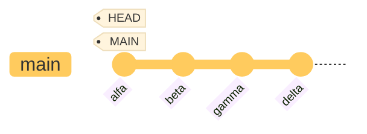
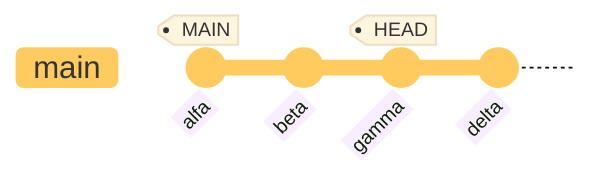

# Other Git functions

## Excluding files from version control

Not all project files should be added to version control.

As a general rule, the following are excluded:

- all files that are not needed in the project,
- build products and build directories,
- generated files,
- logs and temporary files produced by tools,
- files downloaded by package managers, and
- personal configuration files.

All files necessary for development must be added to the repository. If a new developer clones the repository, they should be able to continue development from that point.

### Confidential information

Confidential information such as usernames, passwords, API keys and system configurations should not be added to version control. If they are in version control and pushed to a remote repository, they are visible to everyone who has read access to the repository.

However, confidential information is needed during system development, for example to establish a database connection. In such cases, a solution must be created to provide confidential information to the system in some other way.

The solution can be, for example:

- Confidential information is in a configuration file that is not added to version control
- Confidential information is read from environment variables

In this case, the developer provides the confidential information locally.


### Ignore rules

Git can be configured with rules that specify which files it should ignore. Rules are defined in the `.gitignore` file.

Typically, a project has one `.gitignore` file in the root directory of the project. It applies to the directory in which it is located and recursively to all subdirectories.

### Examples of creating .gitignore rules

Comment lines start with the `#` character. Blank lines are ignored. Normal wildcard patterns (e.g. `*`) work.

Examples:

```
# Ignore all files ending with a tilde (~)
*~

# Ignore all .log files
*.log

# Ignore all .o and .a files
*.[oa]

# Ignore all build directories anywhere in the directory tree
build/

# If a rule starts with a /, it is not applied to subdirectories:
# Ignore only the temp directory in this directory
/temp

# A rule can have an exception with the ! character:
# Ignore all .log files except change.log
*.log
!change.log
```

GitHub provides a wide range of `.gitignore` templates for various projects. They provide a good starting point for configuring your own project ([https://github.com/github/gitignore](https://github.com/github/gitignore)).

### Removing a file from repository

Sometimes something that shouldn't be there gets into the repository because the `.gitignore` file is missing a rule that should have been created.

In this case, you can remove the file from Git control:
```bash
git rm --cached filename
```
The file is marked for removal from the directory in the next commit, but the `--cached` option keeps it in the working directory. The file is now in `untracked` status in your working directory. You can now add a `.gitignore` rule and make a commit that records the file removal.

**Note!** The old versions of the file, however, remain in the history. If you want to remove them from there as well, you need to change the history, which is always risky. Study the documentation carefully if you decide to do this.

## Removing unnecessary files from the working directory

The `clean` command removes all `untracked` files that are not specifically listed in `.gitignore`. You can use it to clean up your working directory of unnecessary files that are not needed in the repository.

Since this command deletes files, it is a good idea to first check what clean would do:

```bash
git clean -d --dry-run            # -d also removes directories
```

When you are sure that the files to be deleted are really unnecessary, you can run the command

```bash
git clean -d
```

The command also has an interactive mode, which always asks what to do:

```bash
git clean -i -d
```

## Tags

Certain named versions can be recorded in the version history. These are typically system release versions (e.g., _v1.0.3_).

In the Git system, this is done with the `tag` command. Tags are references to specific commits, and they can contain metadata such as information about the commit (_annotated tag_):

```bash
git tag -a v1.0.3 -m "v1.0.3"   # -a stands for "annotated"
```

Tags can be listed with the `tag` command. Tag information can be listed with the `show` command:

```bash
git tag
git show v1.0.3
```

A tag can be assigned to any commit later:

```bash
git tag -a v1.2 9fceb02
```

### Tags in remote repositories

Tags are not automatically pushed to the remote repository with the push operation but must be pushed separately. It works the same way as pushing branches:

```bash
git push origin v1.0.3	    # "origin" is the remote repository, "v1.0.3" is the tag
```

All tags can be pushed at once with the `--tags` option:

```bash
git push origin --tags
```

A tag can be deleted with the `-d` option:

```bash
git tag -d v1.0.3
```

### Using tags

Since tags are references to commits like any other references, they can be used in the same way, for example you can view the versions the tag is pointing to:
```bash
git checkout v1.2
```

If you do this, you end up in _detached HEAD_ state

## Detached HEAD

A situation where the HEAD reference does not point to any branch but directly to a single commit is called __detached HEAD__ state.

Let's look at what a normal HEAD state looks like.



HEAD points to the latest commit of the current branch `main`. 

Now let's change to look at the situation at commit `gamma`: 

```bash
git checkout gamma      # use command checkout with commits, switch works only with branches
``` 

The situation now looks like this:



HEAD now does not point to any branch but directly to a single commit. If a commit were made, it would not go into any existing branch. That is why Git gives a warning that HEAD is detached.

You can get out of this state by switching back to some branch, for example `git switch main`.

!!! info "Nice to know"

    If you make commits when HEAD is detached, the commits form a kind of unnamed branch.

    ```mermaid
    ---
    config:
        theme: 'base'
    ---
    gitGraph

    commit id:"alfa" tag:"MAIN" 
    commit id:"beta" 
    commit id:"gamma"
    branch "no name"
    checkout "no name"
    commit
    commit tag:"HEAD"
    checkout "main"
    commit id:"delta"
    ```
    
    If you do not want to keep the commits, you can simply return to some branch, and the commits will not affect any existing branch.

    If, on the other hand, you want to keep them, you can create a new branch for them and switch to it. 

    ```bash
    git branch new-feature
    git switch new-feature
    ```
    Then the branch gets a name and is normally available for use.

    ```mermaid
    ---
    config:
        theme: 'base'
    ---
    gitGraph

    commit id:"alfa" tag:"MAIN" 
    commit id:"beta" 
    commit id:"gamma"
    branch "new-feature"
    checkout "new-feature"
    commit
    commit tag:"HEAD" tag:"new-feature"
    checkout "main"
    commit id:"delta"
    ```

