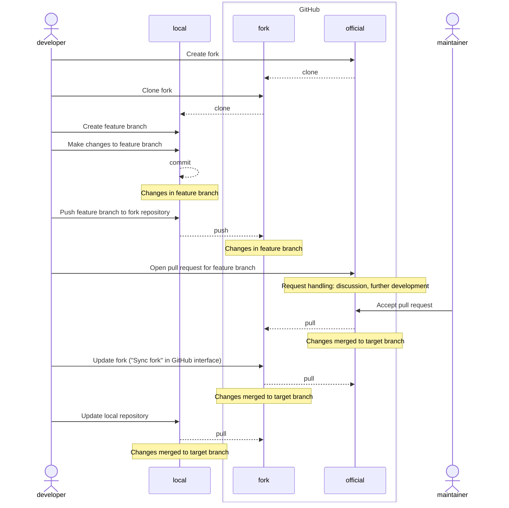

# Pull requests

## Introduction

Git services offer functionality where you can make __pull requests__ to a Git repository (_pull request_, _merge request_). A pull request is a proposal to the repository maintainers to merge the changes made by the person making the request into a branch of the repository.

Pull requests can be supplemented with information about the change, developers can discuss it, the pull request can be further developed, and review workflows can be defined for pull requests.

All Git services offer similar functionality. In this material, GitHub's pull requests are used as an example.

## Making a pull request

The essential information for a pull request is:

- which repository and branch the changes are proposed from
- which repository and branch they should be merged into
- the title and description of the change

The request is made for a branch. Most commonly, the proposed change is made to a feature branch, which is set as the source branch of the pull request. The target branch is usually a common branch agreed upon in the project.

Additionally, a pull request is given:

- a title, which is displayed in listings, and
- a description for the request handlers explaining what the change is and why it is proposed.

In the following example, a pull request is made on GitHub.

First, the proposed change must be made locally. A feature branch is created for it and changes are committed there. The feature branch must be pushed to the remote repository on GitHub so that a pull request can be made for it.

```
git switch -c pull-requests
git add .
git commit -m "Add chapter about pull requests"
git push -u origin pull-requests
```


When the branch is visible in the remote repository, the pull request can be made in GitHub's web interface.


A pull request can be assigned to one or more repository maintainers for review or approval. They will receive a notification about the request.

## Handling a pull request

A pull request can be commented on, and the discussion about it is saved in the pull request.
A pull request can also be expanded, meaning new commits can be made to its branch.


When the request is approved, it can be accepted. In this case, merging happens automatically. If the change would cause conflicts, they must be resolved first.


Merging results in a new commit to the remote repository.


Once the pull request's feature branch is merged, the branch can be deleted from the remote repository.


The local repository now needs to be updated, as the new changes are still only in the remote repository.

```bash
# git switch i18n
Switched to branch 'i18n'
Your branch is up to date with 'origin/i18n'.
```
Note that if you have not fetched the lates changes from the remote, your local repository is unaware of them and claims that your branch is up to date with the remote branch! 

```
# git fetch
remote: Enumerating objects: 1, done.
remote: Counting objects: 100% (1/1), done.
remote: Total 1 (delta 0), reused 0 (delta 0), pack-reused 0 (from 0)
Unpacking objects: 100% (1/1), 913 bytes | 304.00 KiB/s, done.
From https://github.com/mruonavaara/git-versionhallinta
   66b3a1d..081b8a9  i18n       -> origin/i18n
# git status
On branch i18n
Your branch is behind 'origin/i18n' by 3 commits, and can be fast-forwarded.
  (use "git pull" to update your local branch)

nothing to commit, working tree clean
```

Running `fetch` is not mandatory, though. You can just run `pull` which does both fetching and merging.

```
# git pull
Updating 66b3a1d..081b8a9
Fast-forward
 docs/en/pull-requests.md                           | 188 +++++++++++++++++++++
 docs/fi/{yhdistamispyynnot.md => pull-requests.md} |   0
 properdocs.yml                                     |   2 +-
 3 files changed, 189 insertions(+), 1 deletion(-)
 create mode 100644 docs/en/pull-requests.md
 rename docs/fi/{yhdistamispyynnot.md => pull-requests.md} (100%)

```

Note that even though the pull request's remote branch might have been deleted, it still exists locally and must be deleted separately.

```
# git branch
* i18n
  master
  pull-requests
# git branch -d pull-requests
```

## Pull requests between repositories

In the previous example, pull requests were made within a single repository. It is also possible to make requests between different repositories.

In this case, the person making the pull request must have their own __version__ of the repository to which they want to propose changes, and the proposed change branch is made to this repository.

Git services offer a __fork__ function that allows you to create your own version of another repository with a single click. A developer thus always has two versions of the target repository: a fork repository on the Git service and a local repository where changes are made and whose remote repository is the fork.

The access rights of repositories must be configured so that both the person making the pull request and the recipients can see each other's repositories. If they are public, this is always the case.

### Open source version control

In open source projects, anyone can independently develop changes to the project. However, it is not possible to give direct modification rights to the repositories to anyone. In such cases, the forking workflow is used:

1. A developer creates a fork repository on the Git service from the project's official repository. The official repository is public, so their own fork is also public.
2. They clone the fork repository to their computer. Development is done in this repository.
3. In order for their own copy to stay up to date with changes in the official repository, the official repository must also be configured as a remote repository in the local repository. The custom is to name this remote repository `upstream`
4. New development is done in a feature branch.
5. The feature branch is pushed to their own fork repository.
6. The developer opens a new pull request to the official repository. The source branch is set to the feature branch of the fork repository.
7. The maintainer of the official repository handles the pull request. They merge the request's branch first into their own local repository to test it, and then accepts or closes the pull request. The request can be discussed and the request's branch can be further developed.
8. If the request was accepted, the developer must update the contents of their own repositories to match the new content of the official repository. They thus bring their own changes back from the `upstream` remote repository in the branch to which it was merged in the official repository. Now it is official content!



## Pull requests in projects

In projects with multiple developers, pull requests offer the opportunity to discuss changes and work on them together among multiple developers. By using pull requests, the quality and change management of a project can be improved. 

For example:

- it can be required that all changes to the project's main branch are made as pull requests
- pull requests must always be reviewed in a certain way
- automated checks and tests can be run for pull requests

Git services support a wide variety of permission assignments for different users and the implementation of different workflows. You can learn more about these features by familiarizing yourself with your service provider's documentation.

## Exercise 7

Practice making, handling, and accepting pull requests. Normally, multiple people would participate in the workflow, but now you get to play all the roles yourself.

<div class="steps" markdown>

1. Make a pull request to the repository from Exercise 6:

      1. Create a new feature branch in your local repository for the changes
      2. Make optional changes to the feature branch
      3. Push the feature branch to the remote repository
      4. Make a request on GitHub to merge the feature branch into the main branch of your remote repository.
   
2. Comment on your request.
3. Make a second commit to the request's branch and push it to the remote repository.
4. Accept the pull request and delete the feature branch from the remote repository.
5. Update your local repository to match the remote repository's content, and delete the local feature branch.
6. When you have completed the exercise, add a tag `exercise7` to the latest commit by running:

    ```
    git tag exercise7
    ```
</div>

The result should be:

- A new change has been made to the remote repository.
- Clear documentation of the change has been created and is visible in the repository on GitHub.
- The local repository is in the same state as the remote repository.


